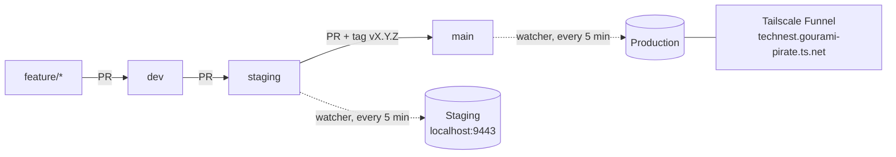

# Deployment (Phase 6)

TechNest runs in three environments on one Windows PC (WSL2 + Docker Desktop). Staging and production are separate clones of the repository with their own database, media and `env.php`, started from the same Compose file [`compose.deploy.yaml`](../compose.deploy.yaml). Production is published on the internet with Tailscale Funnel.

| Environment | Branch | Folder | Compose project | URL | Mode |
|---|---|---|---|---|---|
| Dev | `dev` and `feature/*` | `~/Sites/magento` | `magento` | https://technest.test | developer |
| Staging | `staging` | `~/Sites/technest-staging` | `technest-staging` | https://localhost:9443 (this PC only) | production |
| Production | `main` | `~/Sites/technest-production` | `technest-production` | https://technest.gourami-pirate.ts.net | production |

The PC has 7.8 GB of RAM, so **only one environment runs at a time**. `scripts/env/up.sh` stops the others before it starts.



## 1. Scripts

All scripts live in [`scripts/env/`](../scripts/env) and take the environment name (`staging` or `production`) as their first argument. Run them from WSL.

| Script | What it does |
|---|---|
| `install.sh <env>` | First install: clone, copy `env/*.env`, `setup:install`, seed the catalog, production mode. Safe to run again after a failure |
| `up.sh <env>` | Stop the other stacks, start this one, install cron, open Funnel (production), start the CD watcher |
| `down.sh <env>` | Stop the watcher (waits for a running deploy), close Funnel, stop the stack |
| `deploy.sh <env> [--force]` | Deploy the newest commit of the branch. The watcher runs it every 5 minutes; `--force` rebuilds the current commit |
| `watch.sh <env>` | The CD watcher loop, started by `up.sh`. Also takes a daily DB backup |
| `compose.sh <env> <args>` | `docker compose` for the environment, for example `scripts/env/compose.sh staging ps` |

To run Magento commands in an environment:

```bash
scripts/env/compose.sh staging exec phpfpm bin/magento cache:flush
```

## 2. First install

Do this once per environment. The example uses staging; for production replace `staging` with `production`.

1. In the dev repo, check that `env/phpfpm.env` has `CONFIG__DEFAULT__TECHNEST_SEEDER__ICECAT__USERNAME` (product images and specs) and the SMTP and Google variables.
2. Run `scripts/env/install.sh staging`. It clones the repo, copies `env/*.env` from dev, sets the Google redirect URI to the environment URL, and stops.
3. In `~/Sites/technest-staging/env/magento.env`, set the admin account:
   - `MAGENTO_ADMIN_EMAIL`: a real mailbox, because admin two-factor authentication is on in production mode (the dev-only module that turns it off is not installed with `--no-dev`).
   - `MAGENTO_ADMIN_PASSWORD`: a strong password, not `changeme`.
   - `MAGENTO_ADMIN_FRONTNAME`: the admin URL path; letters, digits and `_` only.
4. Run `scripts/env/install.sh staging` again. It takes about 15–20 minutes: setup:install, `technest:seed:run`, `technest:seed:cleanup-legacy --force` (removes the sample data catalog), production mode, compile, static content, reindex, health check.
5. Run `scripts/env/up.sh staging`.
6. In Google Cloud Console, add the redirect URI `<environment URL>/technest_google/oauth/callback` to the OAuth client.

For production, also turn on Tailscale Funnel once (see section 5).

## 3. Releasing a change

Code moves one way only, always through pull requests. The ruleset `protected-envs` blocks direct pushes, force pushes and deletion of `dev`, `staging` and `main`, and requires a green CI.

1. Work on `feature/<name>` from `dev`, open a PR into `dev`, merge it when CI is green.
2. Check the change on dev, then open a PR from `dev` into `staging` and merge it.
3. If staging is running, its watcher deploys the change within 5 minutes. Watch `~/Sites/technest-staging/logs/watch.log`, then check https://localhost:9443.
4. Open a PR from `staging` into `main` and merge it. Tag the release on `main`:

   ```bash
   git switch main && git pull
   git tag -a v1.0.0 -m "TechNest v1.0.0" && git push origin v1.0.0
   ```

5. Start production (`scripts/env/up.sh production`); its watcher deploys `main`.

Urgent fix: branch `hotfix/<name>` from `main`, PR into `main`, then merge `main` into `staging` and `dev` so the fix is not lost.

## 4. How a deploy works

`deploy.sh` runs in the clone of the environment. It holds `backups/deploy.lock`, so two deploys never overlap.

1. `git fetch`; stop if the clone is already on the newest commit of its branch.
2. Back up the database: `backups/deploy-<date>-<old commit>.sql.gz`.
3. Maintenance mode on (the flag file is written directly, so this works even when `bin/magento` cannot start), cron off.
4. `git checkout --force` the new commit, `composer install --no-dev`, regenerate `nginx.conf`.
5. `setup:di:compile`, `setup:static-content:deploy` (`en_US`, `vi_VN`), optimized class map.
6. `setup:upgrade --keep-generated` (schema and data patches), `cache:flush`, maintenance off, cron on.
7. Health check: the home page and the login page must answer 200 and contain "TechNest".

If any step fails, `deploy.sh` rolls back: it restores the database from step 2 and releases the previous commit the same way. If the rollback fails too, the store stays in maintenance mode and `watch.log` says so; fix the cause, then run `scripts/env/deploy.sh <env> --force`.

A deploy takes about 10 minutes, most of it compile and static content.

## 5. Production on the internet: Tailscale Funnel

Tailscale runs on Windows and forwards `https://technest.gourami-pirate.ts.net` to `https+insecure://localhost:8443` (the nginx container). Tailscale issues the public certificate. Only nginx is published, and only on `127.0.0.1`; the database, Valkey, OpenSearch and RabbitMQ have no host ports.

One-time setup, in the Tailscale admin console:

1. **DNS**: enable MagicDNS and HTTPS Certificates.
2. **Access controls**: allow Funnel for this machine (the console offers a button for it).

After that, `up.sh production` opens Funnel (`tailscale funnel --bg`) and `down.sh production` closes it (`tailscale funnel reset`).

The site is online only while the PC is on, awake, and production is up. Turn off sleep on the PC during a demo.

## 6. Backups

| File | When |
|---|---|
| `~/Sites/technest-<env>/backups/deploy-*.sql.gz` | Before each deploy |
| `~/Sites/technest-<env>/backups/daily-*.sql.gz` | Once a day, by the watcher |

The 7 newest of each kind are kept. Restore by hand (replaces the whole database):

```bash
cd ~/Sites/magento
source scripts/env/lib.sh && tn_env staging
tn_maintenance_on && tn_restore ~/Sites/technest-staging/backups/daily-<date>.sql.gz
tn_magento cache:flush && tn_magento maintenance:disable
```

Media files (`src/pub/media`) are not in the dump. They are rebuilt by `technest:seed:run`.

## 7. Secrets

Secrets never go into the repository.

| Secret | Where |
|---|---|
| DB, RabbitMQ, admin password | `~/Sites/technest-<env>/env/*.env` |
| SMTP (Gmail App Password), Google OAuth client, Icecat username | `~/Sites/technest-<env>/env/phpfpm.env` |
| Magento encryption key | `~/Sites/technest-<env>/src/app/etc/env.php` |
| `COMPOSER_AUTH` for CI | GitHub Secrets |

Templates without values are in `env/*.env.example`.

## 8. Troubleshooting

| Symptom | Cause and fix |
|---|---|
| The PC freezes during a deploy | Out of RAM. Keep `C:\Users\<you>\.wslconfig` at `memory=5632MB` and `swap=4GB` so Windows keeps about 2 GB, and close heavy browser tabs while a deploy runs |
| After a Windows restart the site answers 404 or 502 | Docker Desktop started the containers before the WSL disk was mounted, so `src/` is empty inside them. Run `scripts/env/up.sh <env>`: it recreates the containers |
| `docker` says it cannot connect to `/var/run/docker.sock` | Docker Desktop lost the WSL connection. Quit and reopen Docker Desktop; check *Settings → Resources → WSL integration* |
| Site in maintenance mode (503) after an interrupted deploy | Run `scripts/env/deploy.sh <env> --force` |
| `Failed to open stream: ... generated/code/.../Proxy.php` | The optimized class map lists generated files that were deleted. Run `scripts/env/deploy.sh <env> --force`: `composer install` rebuilds the class map first |
| `watch.log` repeats "Another deploy is running" | A deploy is still running (or hung). Check with `pgrep -af deploy.sh` |

Only run `wsl --shutdown` when no deploy is running (`watch.log` shows no deploy in progress), or after `scripts/env/down.sh <env>`. Shutting down mid-deploy leaves the store in maintenance mode until the next `deploy.sh --force`.
